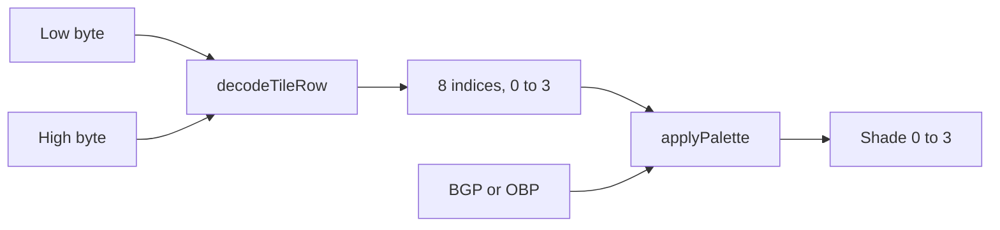
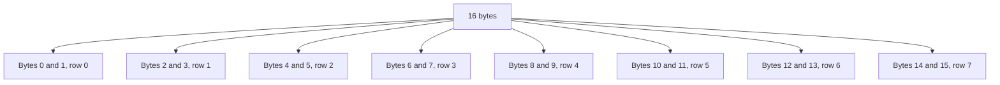
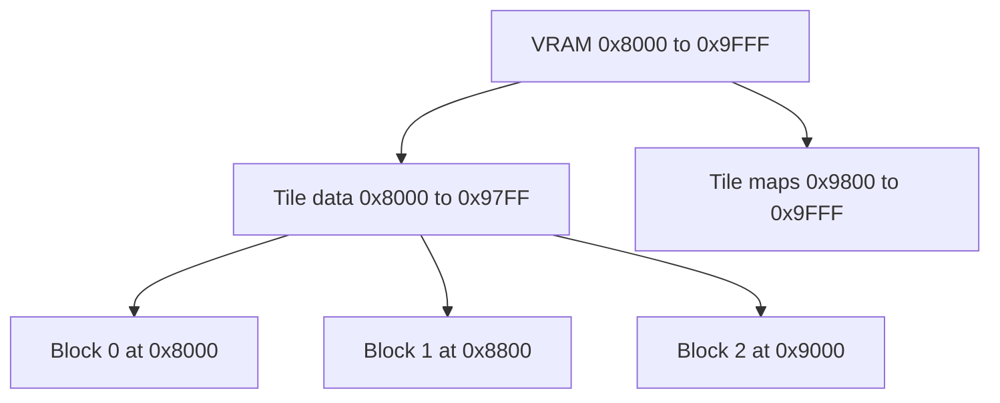

# Lesson 13: Tiles & framebuffer

`decodeTileRow`, `decodeTile`, and `applyPalette` in `src/ppu/tiles.ts` turn Game Boy tile bytes into color indices, then into shades. This lesson edits that file. Lesson 14 is the first lesson that reads the bytes from VRAM and writes `Ppu.framebuffer`.

Pan Docs: https://gbdev.io/pandocs/Tile_Data.html

A color index and a shade are two steps. The tile bytes store an index from 0 to 3. `applyPalette` looks that index up in BGP, OBP0, or OBP1 and returns a shade from 0 to 3. Palette `0xE4` maps each index to the same shade.



## One row

A tile row is two bytes and eight pixels. The low byte holds bit 0 of each pixel. The high byte holds bit 1. Bit 7 is the leftmost pixel and goes in index 0 of the returned array. Bit 0 is the rightmost pixel.

```text
color = (highBit << 1) | lowBit
```

| Low bit | High bit | Index |
| --- | --- | --- |
| 0 | 0 | 0 |
| 1 | 0 | 1 |
| 0 | 1 | 2 |
| 1 | 1 | 3 |

The high bit is the 2's place. `decodeTileRow(0xFF, 0x00)` is eight pixels of color 1. The full-tile test checks that row.

`decodeTileRow(0x80, 0x80)` is the row test. Both bytes are `10000000`, so only the leftmost pixel has both bits set.

| Pixel | 0 | 1 | 2 | 3 | 4 | 5 | 6 | 7 |
| --- | --- | --- | --- | --- | --- | --- | --- | --- |
| Bit | 7 | 6 | 5 | 4 | 3 | 2 | 1 | 0 |
| Low `0x80` | 1 | 0 | 0 | 0 | 0 | 0 | 0 | 0 |
| High `0x80` | 1 | 0 | 0 | 0 | 0 | 0 | 0 | 0 |
| Index | 3 | 0 | 0 | 0 | 0 | 0 | 0 | 0 |

This next row is an illustration, and the tests do not use it. Low `0xCA` (`11001010`) and high `0xAC` (`10101100`) produce every index:

| Pixel | 0 | 1 | 2 | 3 | 4 | 5 | 6 | 7 |
| --- | --- | --- | --- | --- | --- | --- | --- | --- |
| Low `0xCA` | 1 | 1 | 0 | 0 | 1 | 0 | 1 | 0 |
| High `0xAC` | 1 | 0 | 1 | 0 | 1 | 1 | 0 | 0 |
| Index | 3 | 1 | 2 | 0 | 3 | 2 | 1 | 0 |

## A 16-byte tile

One tile is 8×8 pixels, 2 bits per pixel, 16 bytes. `decodeTile` returns eight rows. Row `y` uses byte `2 * y` as the low plane and byte `2 * y + 1` as the high plane.



The full-tile test stores `FF 00` and then 14 zero bytes. Row 0 is eight 1s. Rows 1–7 are eight 0s.

```text
FF 00  →  1 1 1 1 1 1 1 1
00 00  →  0 0 0 0 0 0 0 0
00 00  →  0 0 0 0 0 0 0 0
00 00  →  0 0 0 0 0 0 0 0
00 00  →  0 0 0 0 0 0 0 0
00 00  →  0 0 0 0 0 0 0 0
00 00  →  0 0 0 0 0 0 0 0
00 00  →  0 0 0 0 0 0 0 0
```

## Where the bytes live

These functions take the 16 bytes you already have. They do not address VRAM.

VRAM `0x8000`–`0x97FF` holds the tile data: 384 tiles, 16 bytes apart, in three blocks of 128 tiles. Tile `n` in a block starts at `base + n * 16`.



Sprites always take their tiles from `0x8000`. Lesson 14 chooses the background block from LCDC and reads the tile maps.

## Palette

BGP (`0xFF47`), OBP0 (`0xFF48`), and OBP1 (`0xFF49`) use the same packing. The register holds four shades, 2 bits each, starting at the low end. Index 0 owns bits 1–0, index 1 owns bits 3–2, index 2 owns bits 5–4, and index 3 owns bits 7–6. The pair for index `n` starts at bit `n * 2`.

Shift right by `n * 2` so that pair lands in bits 1–0. Mask with `0x03` (`00000011`) so the bits that moved in from the left are discarded.

```text
shade = (palette >> (colorIndex * 2)) & 0x03
```

`0xE4` is `11100100`. Index 2 starts at bit 4, and the shift still leaves shade 2:

```text
11100100
>> 4
00001110
&  00000011
       10   = 2
```

| Bits | Index | Pair in `0xE4` | Shade |
| --- | --- | --- | --- |
| 1–0 | 0 | `00` | 0 |
| 3–2 | 1 | `01` | 1 |
| 5–4 | 2 | `10` | 2 |
| 7–6 | 3 | `11` | 3 |

`0x1B` is `00011011`, the same pairs in reverse. The shade is the pair itself. Index 0 is bits 1–0, which are `11`, shade 3. Index 1 shifts by 2 and leaves `10`, shade 2.

```text
00011011          index 0, shift 0
&  00000011
       11   = 3

00011011
>> 2              index 1
00000110
&  00000011
       10   = 2
```

| Bits | Index | Pair in `0x1B` | Shade |
| --- | --- | --- | --- |
| 1–0 | 0 | `11` | 3 |
| 3–2 | 1 | `10` | 2 |
| 5–4 | 2 | `01` | 1 |
| 7–6 | 3 | `00` | 0 |

## Files to edit

- `src/ppu/tiles.ts`
