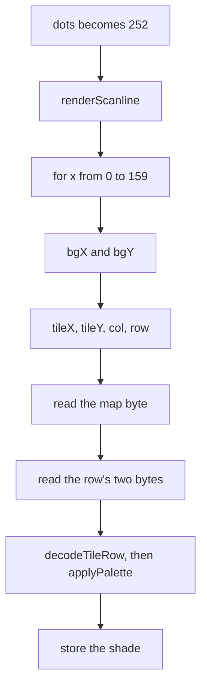

# Lesson 14: Background & scroll

`Ppu` in `src/ppu/ppu.ts` reads VRAM through the `Memory` passed to its constructor and writes shades into `framebuffer`. `decodeTileRow` and `applyPalette` from lesson 13 turn one tile row into a shade. This lesson’s `step` counts dots. The cycle that enters HBlank calls `renderScanline`, which fills one background line.

Pan Docs: https://gbdev.io/pandocs/LCDC.html

## Registers

`read` and `write` store these four fields. The fields are already on `Ppu`.

| Address | Field | Role |
| --- | --- | --- |
| `0xFF40` | `lcdc` | LCD control |
| `0xFF42` | `scy` | Background scroll Y |
| `0xFF43` | `scx` | Background scroll X |
| `0xFF47` | `bgp` | Background palette |

The register test writes `0x91`, `0x10`, `0x20`, and `0xE4`, then reads each address back.

## LCDC

`0x91` is `10010001`. Every render test assigns that value to `lcdc`.

| Bit | Value in `0x91` | Role in this lesson |
| --- | --- | --- |
| 7 | 1 | LCD enable. `step` counts dots while this bit is set. |
| 4 | 1 | Background tile data. `1` is unsigned at `0x8000`. `0` is signed at `0x9000`. |
| 3 | 0 | Background tile map. `0` is `0x9800`. `1` is `0x9C00`. |
| 0 | 1 | Background enable. The scanline is taken from the map while this bit is set. |

Bits 6 and 5 belong to the window. Bits 2 and 1 belong to sprites. `0x91` leaves both off, so those branches stay idle. Lesson 15 advances `ly` at the end of the 456-dot line, requests VBlank, and writes the mode into `STAT`. Lesson 16 draws sprites.

## When `step` draws

Keep a dot counter that starts at 0 and a mode that starts at 2. Both live on the `Ppu` and survive from one `step` call to the next.

`step(cycles)` returns at once while LCDC bit 7 is clear. Otherwise it runs `cycles` times. Each pass adds one to the counter, then picks the mode from the new value.

| Dots | Mode | Phase |
| --- | --- | --- |
| 0–79 | 2 | OAM scan |
| 80–251 | 3 | Pixel transfer |
| 252–455 | 0 | HBlank |

The line is drawn on the pass that changes the mode into 0. A fresh `Ppu` reaches that pass when the counter becomes 252. Later HBlank dots find the mode already 0, so the line is drawn once.

The solid-tile test calls `step(251)` first. The counter stops at 251, which is still pixel transfer, and `framebuffer[0]` through `framebuffer[159]` stay 0. `ly` stays 0. The following `step(1)` adds the 252nd dot, enters HBlank, and draws line 0.

## `renderScanline`

That HBlank transition calls `renderScanline` once. The function walks `x` from 0 through 159. Each pass reads one background pixel and writes `framebuffer[ly * 160 + x]`.



```text
bgX = (scx + x) & 0xFF
bgY = (scy + ly) & 0xFF
tileX = bgX >> 3
col   = bgX & 7
tileY = bgY >> 3
row   = bgY & 7
mapAddr  = mapBase + tileY * 32 + tileX
tileAddr = 0x8000 + tileIndex * 16          when LCDC bit 4 is set
shade    = applyPalette(decodeTileRow(low, high)[col], bgp)
framebuffer[ly * 160 + x] = shade
```

`mapBase` is `0x9800` when LCDC bit 3 is clear and `0x9C00` when it is set. Read the map byte and the two tile bytes with the `Memory` passed to the constructor. `Bus.vram` is that memory: address `0x8000` is `vram[0]`, and map `0x9800` is `vram[0x1800]`. The tests write `bus.vram`, and the `Ppu` is constructed with that bus.

When LCDC bit 4 is clear, the map byte is a signed index. An index `>= 128` becomes `index - 256`, and the tile starts at `0x9000 + signedIndex * 16`.

## Where one pixel sits

The background is 32 by 32 tiles, 256 by 256 pixels. The screen is a 20 by 18 tile window, 160 by 144 pixels. Its top-left background pixel is `(scx, scy)`. Both axes wrap with `& 0xFF`.

```text
One map row, 32 tiles. The screen shows 20 of them when scx is 0.

tileX   0     1     2           19   |  20          31
      [ 0 ] [ 1 ] [ 2 ]  ...  [ 19 ] | [ 20 ]  ... [ 31 ]
        ^---------- 160 screen pixels ----------^

One of those cells is an 8 by 8 tile. bgX = tileX * 8 + col.

col     0  1  2  3  4  5  6  7
row 0   .  .  .  .  .  .  .  .     bytes tileAddr + 0 and tileAddr + 1
row 1   .  .  .  .  .  .  .  .     bytes tileAddr + 2 and tileAddr + 3
```

`tileY` and `row` split `bgY` the same way. Row `row` of the tile is the byte pair at `tileAddr + row * 2`.

Pixel `x = 0` of the solid fixture follows the diagram with every coordinate at 0. The fixture fills tile 0 with sixteen `0xFF` bytes and writes `0` at `vram[0x1800]`. `lcdc` is `0x91`, `bgp` is `0xE4`, and `ly`, `scx`, and `scy` are 0.

```text
x = 0, ly = 0, scx = 0, scy = 0
bgX = 0, bgY = 0
tileX = 0, col = 0, tileY = 0, row = 0
mapAddr  = 0x9800                         vram[0x1800] returns tile 0
tileAddr = 0x8000 + 0 * 16 + 0 * 2        bytes 0x8000 and 0x8001 are 0xFF
decodeTileRow(0xFF, 0xFF) = [3, 3, 3, 3, 3, 3, 3, 3]
applyPalette(3, 0xE4) = 3
framebuffer[0] = 3
```

The rest of map row 0 is 0 too, so every screen pixel on the line selects tile 0. All 160 shades are 3.

## The map byte

The next fixture gives the first cell a different tile. `vram[0]` through `vram[15]` are `0x00`, so tile 0 is color 0 and `applyPalette(0, 0xE4)` is 0. `vram[16]` through `vram[31]` are `0xFF`, so tile 1 starts at `0x8010` and is shade 3. `vram[0x1800] = 1`. The rest of the map row stays 0.

```text
tileX      0        1        2       ...   19
map byte   1        0        0       ...    0
tile       0x8010   0x8000   0x8000  ...  0x8000
pixels     0-7      8-15     16-23   ...  152-159
shade      3        0        0       ...    0
```

After `step(252)`, pixels `0–7` are shade 3 and pixels `8–159` are shade 0.

## Scroll

Tile 0’s first two bytes are `0x80, 0x80` and the rest are 0, so row 0 is a single 3 in column 0:

```text
col        0  1  2  3  4  5  6  7
tile 0     3  0  0  0  0  0  0  0
```

Tile 1 is sixteen `0xFF` bytes, shade 3 in every column. Map row 0 stays tile 0, so that `3 0 0 0 0 0 0 0` pattern repeats every eight screen pixels. Map row 1, `vram[0x1820]` through `vram[0x183F]`, is tile 1. Each scroll pair is a new `Ppu`, so the counter starts at 0 and `step(252)` draws once.

`scx = 0`, `scy = 0`. The window starts at column 0. Screen pixels `0` and `8` are that leading 3. Pixel `1` is column 1, shade 0.

```text
screen x   0  1  2  3  4  5  6  7 | 8  9
bgX        0  1  2  3  4  5  6  7 | 8  9
shade      3  0  0  0  0  0  0  0 | 3  0
           \______ tileX 0 ______/ \ tileX 1, still tile 0's pattern
```

`scx = 1`, `scy = 0`. The window starts one pixel later. Pixel `0` has `bgX = 1`, so `col = 1` and the shade is 0. Pixel `7` has `bgX = 8`, so `tileX = 1`, `col = 0`, and the shade is the next copy of the leading 3.

```text
screen x   0  1  2  3  4  5  6  7 | 8
bgX        1  2  3  4  5  6  7  8 | 9
col        1  2  3  4  5  6  7  0 | 1
shade      0  0  0  0  0  0  0  3 | 0
                                 ^ col 0 of tileX 1
```

`scx = 0`, `scy = 8`. `bgY = 8`, so `tileY = 1` and `row = 0`. The map address is `0x9800 + 32 + tileX`, which is `vram[0x1820 + tileX]`, tile 1. Every cell on the line is shade 3.

```text
scy = 0    map row 0 at vram[0x1800]    tile 0 pattern
scy = 8    map row 1 at vram[0x1820]    tile 1, shade 3 across all 160 pixels
```

## Files to edit

- `src/ppu/ppu.ts`
